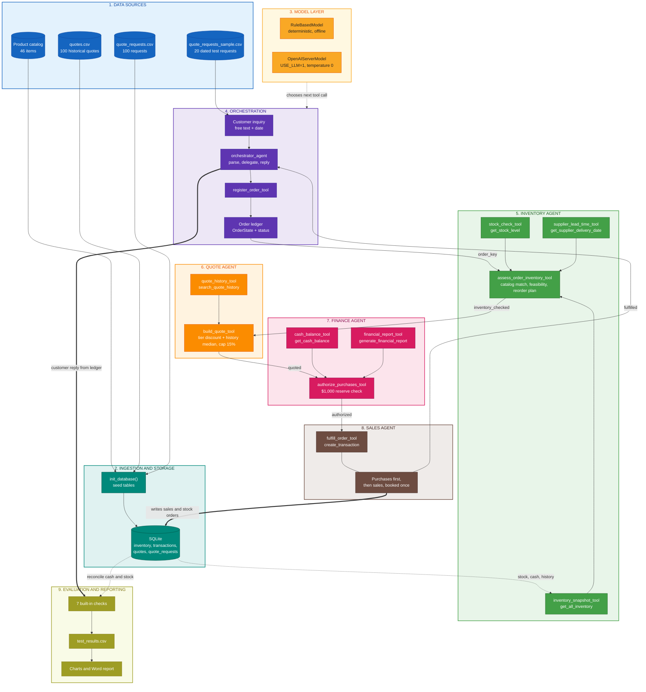

# Beaver's Choice Paper Company: Multi-Agent Quote, Inventory and Sales System

A five-agent system built with [smolagents](https://huggingface.co/docs/smolagents/examples/multiagents) that turns free-text customer inquiries into accurate, explainable quotes, checks stock and supplier lead times, protects cash, and records completed sales in a SQLite database. It rejects what it cannot deliver and always tells the customer why.

> **Highlights.** 20 sample requests evaluated: 10 fulfilled in full, 9 fulfilled in part, 1 rejected with a clear reason. Cash rose from $45,059.70 to $46,804.87. All seven built-in requirement checks pass in the offline run and in the final live-LLM run.

## Table of contents

1. [Overview](#overview)
2. [Key results](#key-results)
3. [Architecture](#architecture)
4. [Agents and tools](#agents-and-tools)
5. [Business rules](#business-rules)
6. [Dataset](#dataset)
7. [Getting started](#getting-started)
8. [Project structure](#project-structure)
9. [Testing and verification](#testing-and-verification)
10. [Evaluation results](#evaluation-results)
11. [Lessons from the live runs](#lessons-from-the-live-runs)
12. [Limitations](#limitations)
13. [Roadmap](#roadmap)
14. [References](#references)

## Overview

The company sells paper, party supplies and specialty products. Customers write in everyday language, ask for several products at once, and set delivery deadlines. Handling this by hand is slow and inconsistent, so this project automates the whole path from inquiry to booked sale.

The design follows four principles:

- **Business rules live in plain Python functions, not prompts.** Agents call them as tools, so prices, quantities and database writes are exact and testable.
- **A shared order ledger.** Workers pass an `order_key` instead of retyping data, which removes transcription errors.
- **The customer reply is rendered from the ledger,** never from model free text.
- **Every workflow step runs only from its own status,** so a repeated or out-of-order call cannot corrupt an order, and each order is booked at most once.

The agents can run on a deterministic `RuleBasedModel` (reproducible, offline, the default) or on a live OpenAI-compatible model with `USE_LLM=1`. Both modes use the same agents, tools and safeguards.

## Key results

| Measure | Result |
|---|---|
| Requests evaluated | 20 |
| Fulfilled in full / in part / rejected | 10 / 9 / 1 |
| Product lines supplied / declined | 42 / 18 (14 missed the deadline, 4 not in catalog) |
| Sales revenue booked | $4,142.92 |
| Supplier purchases | $2,397.75 |
| Cash balance | $45,059.70 to $46,804.87 |
| Total assets | $50,000.00 to $51,209.42 (+2.4%) |
| Built-in requirement checks | 7 of 7 pass |
| Live run 3 versus offline run | Identical outcomes, cash changes and final cash |

The mandatory rule that at least three orders are fulfilled and at least one is actively rejected with a clear customer reason is met. Request 15 is rejected because 10,000 A4 and 5,000 A3 colored sheets cannot arrive by April 15 (earliest delivery April 19) and cardboard is not stocked. The reply states each reason and confirms that no charge was made.

## Architecture

The diagram shows the data science flow from raw data to decisions, database writes and evaluation. Each node group has its own color palette.



A static image of the same diagram is in [`docs/architecture_data_science_flow.png`](docs/architecture_data_science_flow.png), and its source is [`docs/architecture_data_science_flow.mmd`](docs/architecture_data_science_flow.mmd). A tool-level diagram that also lists each tool's purpose is in [`multi_agent_workflow.png`](multi_agent_workflow.png).

**Control flow.** The orchestrator registers the order and calls the inventory agent, then the quote agent, then the finance agent, then the sales agent, and finally composes the reply. There are two exits: if no requested line can be supplied the flow ends after the inventory step, and if required purchases are unaffordable it ends after the finance step.

**Order status machine.** `registered` to `inventory_checked` to `quoted` to `authorized` to `fulfilled`, with `rejected` reachable after the inventory or finance step. Each worker acts only on the status that belongs to it.

**Layers.**

| Layer | Components | Responsibility |
|---|---|---|
| Interface | `orchestrator_agent` | Parse inquiry, delegate, reply |
| Agents | inventory, quote, finance, sales | Call tools in their domain |
| Logic | `assess_inventory`, `build_quote`, `authorize_purchases`, `fulfill_order` | Exact business rules |
| State | `ORDER_BOOK`, `ACTIVE_REQUEST` | Share order data between agents |
| Data | Seven starter helpers and SQLite | Read and write all records |
| Models | `RuleBasedModel` or `OpenAIServerModel` | Choose the next tool call |

## Agents and tools

Five smolagents `ToolCallingAgent`s and twelve tools. The orchestrator holds the four workers as `managed_agents`.

| Agent | Responsibility | Tools | Starter helper used |
|---|---|---|---|
| `orchestrator_agent` | Parse inquiry, register order, delegate, compose reply | `register_order_tool`, `compose_customer_response_tool` | None (order ledger) |
| `inventory_agent` | Map wording to catalog items, check stock and lead time, plan reorders | `inventory_snapshot_tool`, `stock_check_tool`, `supplier_lead_time_tool`, `assess_order_inventory_tool` | `get_all_inventory`, `get_stock_level`, `get_supplier_delivery_date` |
| `quote_agent` | Price accepted lines, apply history-informed bulk discount | `quote_history_tool`, `build_quote_tool` | `search_quote_history` |
| `finance_agent` | Check cash and financial health, authorize purchases | `cash_balance_tool`, `financial_report_tool`, `authorize_purchases_tool` | `get_cash_balance`, `generate_financial_report` |
| `sales_agent` | Book supplier purchases and customer sales | `fulfill_order_tool` | `create_transaction` |

Safeguards around the model: the customer reply comes from the ledger, any stage left unfinished is completed by the same functions the tools call, tools ignore invented order keys and take the date, deadline and event from the trusted request text, and item JSON is repaired or replaced by the rule parser when unusable.

## Business rules

| Parameter | Value | Purpose |
|---|---|---|
| Supplier cost ratio | 60% of catalog price | Keeps discounted sales profitable |
| Cash reserve | $1,000 | Never spent on replenishment |
| Default reorder point | 100 units | For items not in the starting inventory |
| Safety top-up | 2 times the reorder point | Restores stock after a sale |
| Discount tiers | 5% from 500 units, 7% from 1,000, 10% from 5,000 | Rewards bulk orders |
| History blend | Average of tier and median historical discount | Anchors pricing to past quotes |
| Discount cap | 15% | Protects margin |
| Supplier lead time | 0 days up to 10 units, 1 day up to 100, 4 days up to 1,000, 7 days above | Feasibility against deadlines |
| Partial fulfilment | Enabled (`ALLOW_PARTIAL_FULFILLMENT`) | Ships what can be supplied, explains the rest |

Setting `ALLOW_PARTIAL_FULFILLMENT = False` gives all-or-nothing behavior (10 fulfilled and 10 rejected on the sample).

## Dataset

| File | Records | Used for |
|---|---|---|
| Product catalog (`paper_supplies` in the script) | 46 items (25 paper, 15 product, 4 specialty, 2 large format) | Names, categories, unit prices |
| `quotes.csv` | 100 historical quotes | Pricing context and discount history |
| `quote_requests.csv` | 100 historical requests | Loaded into the `quote_requests` table |
| `quote_requests_sample.csv` | 20 dated requests (April 2025) | Evaluation set |
| Seeded `inventory` table | 18 items, 9,627 units, $4,940.30 | Starting stock |

The database (`munder_difflin.db`) has four tables: `transactions`, `inventory`, `quotes` and `quote_requests`. Historical order sizes are 38 small, 27 medium and 35 large. Quote totals are heavily skewed (median $152, maximum $231,500) and one record has a negative total, which the system ignores because it reads only discount wording.

## Getting started

**Prerequisites:** Python 3.10 or newer (developed and tested on 3.12). Live mode also needs an OpenAI-compatible API key.

```bash
# 1. Install dependencies
pip install -r requirements.txt

# 2. Deterministic run (reproducible, offline). Writes test_results.csv
python project_starter.py

# 3. Optional: drive the same agents with a live LLM
echo "OPENAI_API_KEY=your_key_here" > .env
USE_LLM=1 python project_starter.py
```

Live mode uses `gpt-4o-mini` at temperature 0 through `https://openai.vocareum.com/v1`. Change `MODEL_ID` and `API_BASE_URL` at the top of the agent section of `project_starter.py` to use another endpoint. Each run recreates the database, so runs do not affect each other.

A successful run ends with a requirement summary similar to:

```text
===== REQUIREMENT CHECKS =====
[PASS] all sample requests evaluated
[PASS] >= 3 requests fulfilled
[PASS] >= 1 request rejected with a reason
[PASS] >= 3 requests changed the cash balance
[PASS] every required helper used by a tool
[PASS] each order booked exactly once (booked sales == quoted totals)
[PASS] no customer reply leaks internal data
Fulfilled/partial: 19 | Not fulfilled: 1 | Cash-changing requests: 19
```

## Project structure

```text
/
|-- project_starter.py                 # Complete solution: starter helpers, business logic, tools, agents, evaluation
|-- README.md                           # This file
|-- requirements.txt                    # Python dependencies
|-- test_results.csv                    # Output for the 20 sample requests
|-- quotes.csv                          # Historical quotes
|-- quote_requests.csv                  # Historical requests
|-- quote_requests_sample.csv           # Evaluation requests
|-- multi_agent_workflow.mmd / .png     # Tool-level workflow diagram
|-- docs/
|   |-- architecture_data_science_flow.mmd   # Colored data science flow (Mermaid source)
|   `-- architecture_data_science_flow.png   # Rendered image
|-- reports/
|   |-- Beaver's Choice Paper Company – Multi-Agent System Reflective Report   # reflection report
`-- Multi_Agent_System_Report.pdf      # Comprehensive 30-page report
```

## Testing and verification

| Layer | What it proves | Result |
|---|---|---|
| Seven built-in checks | project requirements and booking integrity | 7 of 7 pass |
| Ledger reconciliation | Cash equals sales minus purchases | Exact match |
| Stock integrity | No negative stock on any date | Pass |
| Faulty-model simulation | Wrong key, broken JSON, skipped workers, leaky text | Identical output to the clean run |
| Re-run simulation | Repeated inventory call after booking | No duplicate booking |
| Cash-starved scenario | Unaffordable order is rejected safely | Rejected with a customer-safe reason |
| All-or-nothing mode | Policy switch works | 10 fulfilled, 10 rejected |
| Determinism | Two offline runs agree | Identical replies |
| Live runs 1 to 3 | Real model behavior | Run 3 matches offline exactly |

The helper check wraps the seven starter helpers at run time and counts calls made from tools, so it proves each helper is used rather than asserting it.

## Evaluation results

Requests are processed in date order (requests 12 and 13 share a date, so 13 runs first).

| Req. | Date | Outcome | Quote ($) | Cash change ($) | Lines ok / not |
|---|---|---|---|---|---|
| 1 | 2025-04-01 | Fulfilled | 100.00 | 100.00 | 3 / 0 |
| 2 | 2025-04-03 | Partial | 129.50 | 9.50 | 2 / 1 |
| 3 | 2025-04-04 | Partial | 468.00 | 151.26 | 2 / 1 |
| 4 | 2025-04-05 | Fulfilled | 80.94 | 55.35 | 2 / 0 |
| 5 | 2025-04-05 | Fulfilled | 123.53 | 48.53 | 3 / 0 |
| 6 | 2025-04-06 | Fulfilled | 70.45 | 15.85 | 3 / 0 |
| 7 | 2025-04-07 | Fulfilled | 622.20 | 443.76 | 4 / 0 |
| 8 | 2025-04-07 | Fulfilled | 648.00 | 200.52 | 4 / 0 |
| 9 | 2025-04-07 | Fulfilled | 32.50 | 19.00 | 3 / 0 |
| 13 | 2025-04-08 | Partial | 30.00 | 12.00 | 1 / 1 |
| 12 | 2025-04-08 | Fulfilled | 48.10 | 14.50 | 3 / 0 |
| 10 | 2025-04-08 | Fulfilled | 134.12 | 35.12 | 2 / 0 |
| 11 | 2025-04-08 | Fulfilled | 142.45 | 50.05 | 2 / 0 |
| 14 | 2025-04-09 | Partial | 69.38 | 24.38 | 1 / 2 |
| 15 | 2025-04-12 | Not Fulfilled | 0.00 | 0.00 | 0 / 3 |
| 16 | 2025-04-13 | Partial | 114.00 | 105.60 | 2 / 1 |
| 17 | 2025-04-14 | Partial | 47.50 | 47.50 | 1 / 4 |
| 18 | 2025-04-14 | Partial | 20.00 | 8.00 | 1 / 2 |
| 19 | 2025-04-15 | Partial | 137.25 | 47.25 | 1 / 2 |
| 20 | 2025-04-17 | Partial | 1,125.00 | 357.00 | 2 / 1 |

Of 60 distinct product lines, 42 were supplied (70%). Discounts on the 19 booked orders: 5 received none, one 5%, six 7.5%, four 8.5% and three 10%. Flyers produced the most revenue ($675.00) and A4 paper sold the most units (10,450).

## Lessons from the live runs

| Run | Fulfilled (full or part) | Final cash | Finding |
|---|---|---|---|
| Live run 1 | 5 of 20 | Not comparable | Replies contradicted the database, a hallucinated zero cash balance, internal terms leaked |
| Live run 2 | 19 of 20 | $47,095.30 | Three orders booked twice, overstating cash by $290.43 |
| Live run 3 | 19 of 20 | $46,804.87 | Matches the offline run exactly |

A design that is correct under a deterministic model can fail under a real one. The fixes were small but decisive: render replies from the ledger, complete unfinished stages in code, ignore invented keys, and guard every step by status and a `booked` flag. Each defect was reproduced under a simulated model before it was fixed. The final live run made exactly 100 `create_transaction` calls, the same as the offline run, which shows no order was written twice.

## Limitations

- Nine of 20 requests were only partly fulfilled, mostly because orders above 1,000 units need seven days from the supplier.
- Catalog matching is rule based. Qualifiers such as recycled, biodegradable and A5 are not catalog attributes, and A3 glossy or matte paper is matched to the size-agnostic item with a visible note.
- Supplier cost is assumed to be 60% of catalog price because the data has no cost field.
- Sales and their purchases are booked on the request date, and supplier arrival is checked against the deadline but not modeled as a later inventory event.
- The ledger is an in-memory dictionary, which suits a batch evaluation but not a multi-user service.
- Live-model behavior was observed in three runs only, so other failure patterns may exist.

## Roadmap

1. Split deliveries and substitute products when a line misses its deadline.
2. Demand-driven reorder points forecast from the 100 historical requests.
3. A clarification loop for ambiguous items (size, finish, reams versus sheets) and human approval above a value threshold.
4. A margin-aware pricing model learned from historical quotes.
5. A persistent order store with locking for concurrent customers.

## References

All references below were checked on October 7, 2026.

1. Hugging Face. [smolagents: Orchestrate a multi-agent system](https://huggingface.co/docs/smolagents/examples/multiagents)
2. Hugging Face. [smolagents reference: agents](https://huggingface.co/docs/smolagents/reference/agents)
3. Anthropic. [Building effective agents](https://www.anthropic.com/research/building-effective-agents) (December 2024)
4. Yao, S. et al. [ReAct: Synergizing Reasoning and Acting in Language Models](https://arxiv.org/abs/2210.03629). arXiv:2210.03629
5. Wu, Q. et al. [AutoGen: Enabling Next-Gen LLM Applications via Multi-Agent Conversation](https://arxiv.org/abs/2308.08155). arXiv:2308.08155
6. SQLAlchemy. [SQLAlchemy 2.0 Documentation, Unified Tutorial](https://docs.sqlalchemy.org/en/20/tutorial/index.html)
7. pandas. [pandas documentation](https://pandas.pydata.org/docs/)
8. Mermaid. [Flowcharts, basic syntax](https://mermaid.js.org/syntax/flowchart.html)

For the full write-up, including 13 figures and 13 tables, see [Multi_Agent_System_Report](reports/Multi_Agent_System_Report.pdf).
